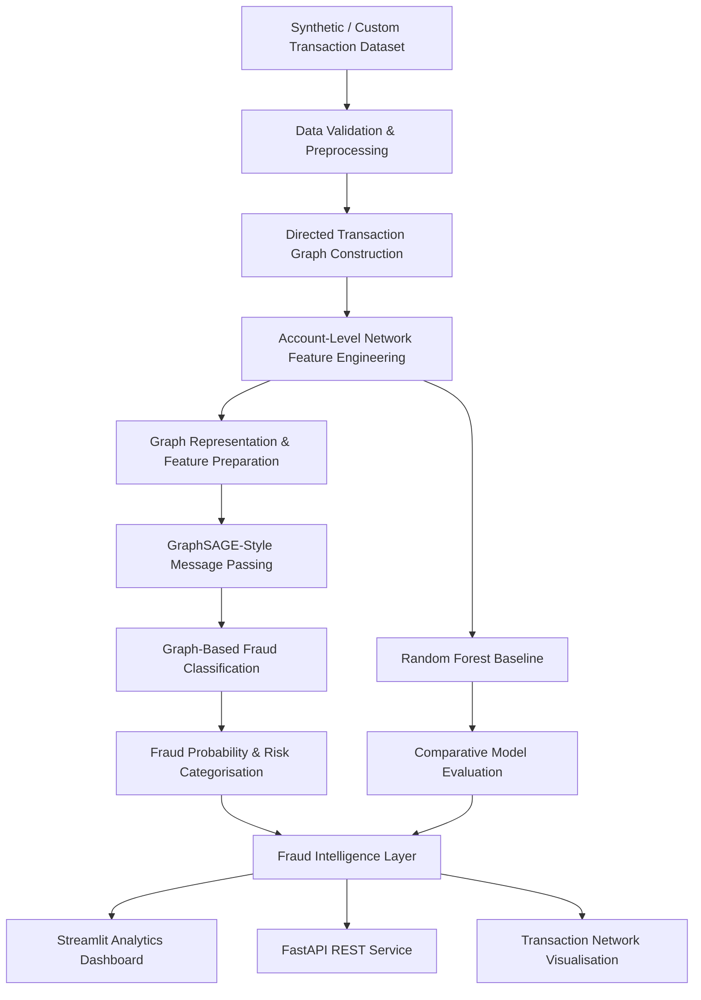
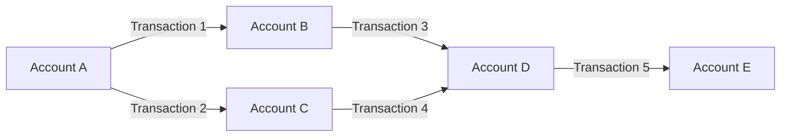

# Graph Neural Network-Based Financial Transaction Network and Fraud Intelligence

An AI-powered financial fraud analytics prototype designed to represent financial transactions as interconnected graphs, identify suspicious transaction patterns, and estimate potential fraud risk using Graph Neural Networks. The system integrates transaction preprocessing, directed graph construction, network feature engineering, GraphSAGE-style message passing, and fraud classification. It also compares graph-based learning with a traditional Random Forest baseline and provides interactive fraud analytics through a Streamlit dashboard and FastAPI REST service.

> **Data and Security Notice:** This project uses entirely synthetic transaction data for educational and research purposes. It does not contain real banking, customer, or UPI transaction records and does not connect to live financial networks, payment gateways, or banking systems. Model predictions are experimental estimates, not verified evidence of fraudulent activity.

## Key Features

- **Synthetic Transaction Generation:** Generates reproducible financial transaction records for graph-based fraud detection experiments.
- **Transaction Preprocessing:** Validates transaction identifiers, timestamps, amounts, payment channels, and target labels.
- **Directed Graph Construction:** Represents financial accounts as nodes and transactions as directed edges using NetworkX.
- **Network Feature Engineering:** Extracts account-level structural and transactional characteristics.
- **Graph Neural Network Classification:** Implements a compact GraphSAGE-style message-passing classifier using PyTorch.
- **Fraud Probability Estimation:** Produces model-based fraud scores and configurable demonstration risk categories.
- **Model Benchmarking:** Compares graph-based classification against a traditional Random Forest baseline.
- **Suspicious Network Analysis:** Explores high-risk transactions, account connections, and network-level patterns.
- **Interactive Dashboard:** Visualises transaction activity, model performance, account-level insights, and fraud predictions through Streamlit.
- **REST API Integration:** Exposes transaction scoring and health-check functionality through FastAPI.
- **Reproducible Experiments:** Includes data generation, training scripts, model artifacts, evaluation reports, and unit tests.

## System Architecture



## Core Analytical Modules

### 1. Transaction Data Generation and Preprocessing

Creates and prepares structured financial transaction records for graph-based analysis.

**Transaction attributes:**

| Attribute | Description |
|---|---|
| Transaction ID | Unique transaction identifier |
| Sender ID | Originating account identifier |
| Receiver ID | Destination account identifier |
| Transaction Amount | Monetary value transferred |
| Timestamp | Transaction time information |
| Payment Channel | Transaction channel or method |
| Fraud Label | Synthetic binary target variable |

Preprocessing operations include:

- Transaction record validation
- Missing-value handling
- Duplicate transaction checks
- Timestamp extraction and transformation
- Categorical feature encoding
- Numerical feature preparation
- Binary target validation

### 2. Financial Transaction Graph Construction

Transforms transaction records into a directed graph using NetworkX.

**Graph representation:**

- **Nodes:** Financial account identifiers.
- **Directed Edges:** Transactions from sender accounts to receiver accounts.
- **Node Attributes:** Account-level activity and network characteristics.
- **Edge Attributes:** Transaction amount, timestamp, payment channel, and associated transaction features.

<text color="secondary" size="xs" weight="medium">ILLUSTRATIVE TRANSACTION NETWORK</text>



This graph representation makes it possible to examine transaction relationships and account connectivity beyond individual transaction records.

### 3. Network Feature Engineering

Extracts structural and transactional information from the graph to support fraud classification.

**Engineered network features:**

- **Degree:** Number of connections associated with an account.
- **Weighted Transaction Volume:** Aggregate transaction value associated with an account.
- **Fraud-Neighbour Ratio:** Proportion of connected accounts or neighbouring transactions associated with known fraud labels, where label availability permits.
- **Account Activity:** Number of transactions associated with an account.
- **Transaction Connectivity:** Measures account relationships and network interaction patterns.

**Important:** Fraud-neighbour features must be calculated using only information available at prediction time. Training or evaluation labels must not leak into test features.

### 4. Graph Neural Network-Based Fraud Classification

Implements a compact GraphSAGE-style message-passing classifier using PyTorch.

**Model:** GraphSAGE-style Graph Neural Network

The model learns account representations by aggregating information from neighbouring nodes and combining it with node-level features.

**Conceptual workflow:**

1. Initialise node representations from engineered account features.
2. Identify neighbouring nodes within the transaction graph.
3. Aggregate neighbouring node information.
4. Combine aggregated information with the current node representation.
5. Apply neural network transformations.
6. Generate graph-based classification predictions.

The resulting representations help the classifier capture structural information that conventional transaction-level models may not directly represent.

### 5. Random Forest Baseline Comparison

Uses a traditional Random Forest classifier as a benchmark against the graph-based approach.

| Model | Approach |
|---|---|
| Random Forest | Conventional supervised learning using engineered transaction and network features |
| GraphSAGE-Style Classifier | Graph-based message passing and neighbour information aggregation |

The comparison helps examine whether incorporating graph structure provides additional predictive value over conventional feature-based classification.

### 6. Fraud Probability and Risk Assessment

Generates model-based fraud probability estimates and assigns configurable demonstration risk bands.

| Risk Category | Interpretation |
|---|---|
| Low | Lower model-estimated fraud probability |
| Medium | Intermediate model-estimated fraud probability |
| High | Higher model-estimated fraud probability |

Risk thresholds should be configurable and treated as experimental settings rather than validated banking fraud thresholds.

A model-generated risk score is not proof of fraudulent behaviour.

### 7. Transaction Network Intelligence

Provides network-level analysis to explore suspicious patterns and account relationships.

- High-risk transaction identification
- Account connectivity analysis
- Transaction volume exploration
- Suspicious connection visualisation
- Account activity comparison
- Network structure exploration
- Model prediction analysis

These capabilities support exploratory investigation of synthetic transaction networks rather than automated accusations or enforcement decisions.

### 8. Interactive Fraud Analytics Dashboard

The Streamlit dashboard presents graph analytics and machine-learning results through an interactive interface.

- Transaction overview and KPI summaries
- Account and transaction activity analysis
- Transaction network visualisation
- High-risk transaction exploration
- Fraud prediction distributions
- Graph model versus Random Forest comparison
- Model evaluation visualisations
- Network feature importance and analysis
- Interactive filtering and data exploration

## Technology Stack

| Category | Technologies |
|---|---|
| Programming Language | Python |
| Data Processing | Pandas, NumPy |
| Graph Processing | NetworkX |
| Deep Learning | PyTorch |
| Graph Learning | GraphSAGE-Style Message Passing |
| Machine Learning | Scikit-learn |
| Baseline Algorithm | Random Forest |
| Data Visualisation | Matplotlib, Plotly |
| Dashboard | Streamlit |
| Backend API | FastAPI, Uvicorn |
| Data Format | CSV, JSON |
| Model Persistence | Joblib, PyTorch |
| Testing | Pytest |
| Development Environment | Jupyter Notebook, VS Code |
| Version Control | Git, GitHub |

## Quick Start

### Prerequisites

- Python 3.10 or later
- pip package manager
- Git (optional)

### 1. Clone the Repository

```bash id="3j7m9x"
git clone <repository-url>
cd <repository-folder>
```

### 2. Create a Virtual Environment

```bash id="6v2q8n"
python -m venv venv
```

**Windows:**
```bash id="4k9p3w"
venv\Scripts\activate
```

**macOS / Linux:**
```bash id="2m5x7q"
source venv/bin/activate
```

### 3. Install Dependencies

```bash id="9w3n6p"
pip install -r requirements.txt
```

### 4. Generate Synthetic Transaction Data

```bash id="7q4m2v"
python scripts/generate_data.py
```

### 5. Train the Fraud Detection Models

```bash id="5p8x1k"
python scripts/train_model.py
```

### 6. Launch the Streamlit Dashboard

```bash id="8n2j6m"
streamlit run app/streamlit_app.py
```

Open the local URL displayed in the terminal to access the fraud analytics dashboard.

### 7. Start the FastAPI Service

```bash id="3x6v9q"
uvicorn api.main:app --reload
```

> **Note:** These commands assume the example paths exist in the repository. Adjust them to match the actual project implementation.

## Working with Custom Datasets

The system can be adapted to compatible transaction datasets.

### Required Input Columns

| Column | Description |
|---|---|
| `transaction_id` | Unique transaction identifier |
| `sender_id` | Originating account |
| `receiver_id` | Destination account |
| `amount` | Transaction amount |
| `timestamp_hour` | Transaction hour or equivalent time feature |
| `channel` | Payment channel |
| `is_fraud` | Binary fraud label: 0 or 1 |

### Data Preparation Workflow

1. Prepare the transaction dataset in CSV format.
2. Verify that required columns and data types are available.
3. Validate transaction identifiers and account relationships.
4. Handle missing and inconsistent values.
5. Ensure the `is_fraud` target contains valid binary labels for supervised training.
6. Run the graph construction and feature engineering pipeline.
7. Train the graph-based classifier and Random Forest baseline.
8. Review model artifacts and evaluation reports.

**Data integrity consideration:** Use chronological or otherwise leakage-safe train/test splitting. Graph features must reflect only the information that would have been available at the prediction time. Fraud labels must not be used to construct features that reveal the target.

## FastAPI Integration

The project includes a lightweight REST API for accessing fraud classification functionality.

### Access API Documentation

Once the API server is running, open:

```text id="1v8m4q"
http://127.0.0.1:8000/docs
```

### API Capabilities

- API health checks
- Transaction risk scoring
- Fraud probability estimation
- Prediction response in JSON format
- Integration with external analytics applications

The actual endpoint names and request/response schemas should follow the implemented FastAPI service.

## Model Evaluation

The graph-based classifier and Random Forest baseline can be evaluated using standard classification metrics.

| Metric | Purpose |
|---|---|
| Accuracy | Measures overall classification correctness |
| Precision | Measures the proportion of predicted fraud cases that are correct |
| Recall | Measures the proportion of actual fraud cases identified |
| F1-Score | Balances precision and recall |
| Confusion Matrix | Shows correct and incorrect predictions |
| ROC-AUC | Evaluates ranking performance across classification thresholds |
| PR-AUC | Evaluates precision-recall performance, particularly useful for imbalanced fraud data |

Fraud datasets are often highly imbalanced. Therefore, accuracy alone is insufficient to assess model effectiveness. Precision, recall, PR-AUC, false-positive rates, and false-negative rates should also be considered.

**Evaluation requirements:**

- Use leakage-safe training and testing procedures.
- Prefer chronological evaluation for time-dependent transaction data.
- Ensure account and graph information does not leak across evaluation boundaries.
- Compare both models under consistent data splits and feature availability.
- Report actual experimental metrics rather than assumed or illustrative results.

## Project Structure

```text id="9p4w6x"
Financial_Transaction_Graph_Intelligence/
│
├── api/
│   └── main.py                  # FastAPI application
│
├── app/
│   └── streamlit_app.py         # Interactive dashboard
│
├── data/
│   └── synthetic_transactions.csv
│
├── artifacts/
│   └── trained_models/          # Saved model artifacts
│
├── reports/
│   └── evaluation/              # Model evaluation reports
│
├── docs/
│   └── methodology.md           # Technical documentation
│
├── notebooks/
│   └── exploratory_analysis.ipynb
│
├── scripts/
│   ├── generate_data.py         # Synthetic data generation
│   └── train_model.py           # Model training pipeline
│
├── src/
│   ├── preprocessing.py          # Transaction preprocessing
│   ├── graph_builder.py          # Graph construction
│   ├── graph_features.py         # Network feature engineering
│   ├── graph_model.py            # GraphSAGE-style classifier
│   ├── baseline_model.py         # Random Forest baseline
│   └── evaluation.py             # Model evaluation
│
├── tests/                        # Unit tests
│
├── requirements.txt
└── README.md
```

*This is a suggested repository layout. Retain the actual filenames, model artifacts, and modules implemented in your project.*

## Limitations

- This repository is an educational research and portfolio prototype, not a production-ready fraud detection system.
- Uses entirely synthetic transaction data rather than real banking, customer, or UPI records.
- The target labels are simulated and may not represent genuine fraudulent transaction behaviour.
- Implements a compact educational GraphSAGE-style model rather than a production-scale graph learning architecture.
- Model performance on synthetic data does not establish real-world fraud detection effectiveness.
- Graph construction and feature engineering may simplify complex financial network relationships.
- Fraud-neighbour features can introduce target leakage if not carefully designed.
- No live banking, UPI, payment gateway, or financial network integration is included.
- Large-scale graph processing, streaming inference, and operational monitoring are outside the prototype's demonstrated scope.

## Responsible AI and Financial Data Security

Financial fraud analytics requires careful consideration of data protection, fairness, transparency, and operational risk.

- Use the system strictly for educational, research, and portfolio demonstration purposes.
- Do not use predictions as the sole basis for blocking transactions or restricting financial accounts.
- Never treat model outputs as verified evidence or use them to accuse individuals of fraud without independent investigation.
- Protect sensitive financial information and follow applicable data protection requirements.
- Evaluate false positives, false negatives, and potential model bias.
- Apply strict controls to prevent training-label leakage and inappropriate use of transaction information.
- Require human investigation, independent validation, and appropriate governance before practical application.
- Never upload real customer information, banking credentials, UPI IDs, or confidential transaction records into this demonstration system.

## Future Enhancements

- Advanced Graph Neural Network architectures such as GAT and GCN
- PyTorch Geometric-based graph learning implementation
- Temporal Graph Neural Networks for transaction sequence analysis
- Dynamic graph construction and evolving network analysis
- Advanced graph anomaly detection
- Explainable Graph Neural Networks
- Imbalanced learning and fraud-focused optimisation
- Real-time transaction stream processing
- Graph database integration
- Model drift and performance monitoring
- Secure containerised deployment and cloud integration

## Disclaimer

This project demonstrates graph-based financial transaction analytics and experimental fraud classification. It is not a certified financial security solution, does not establish actual fraudulent activity, and should not replace established banking controls, professional fraud investigation, or regulatory compliance procedures.

## Author

**Mohamed Riyaz S.**  
Integrated M.Tech – Computer Science and Engineering (Business Analytics)  
Vellore Institute of Technology (VIT), Chennai
